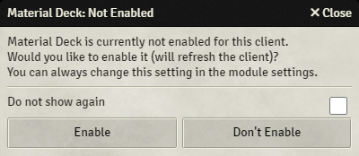
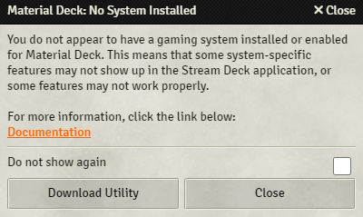

Before you try installing everything, please check the [requirements](./requirements.md).

This guide assumes that you have a [Foundry VTT](https://foundryvtt.com/) server running.

You will need to:

* [Link your Patreon account to your Foundry account](#linking-a-patreon-account)
* Install and enable the [Material Deck module](#module)
* (Optionally) install a [gaming system module](#gaming-system-modules)
* Select a [communication method](#communication-method) and install/configure it
* (Optionally) install a [Stream Deck profile](#stream-deck-profiles)

## Linking a Patreon Account
Material Deck is a premium module that requires a subscription to the [Material Foundry Patreon](https://www.patreon.com/materialfoundry) at the 'Material Apprentice' tier or higher. 
As a patron you can gain access to the module by linking your Patreon account to your Foundry account:

1. Log in on the [Foundry VTT website](https://foundryvtt.com/)
2. Edit your profile [here](https://foundryvtt.com/me/edit)
3. Link your Patreon account at the bottom of the page if you haven't already
4. Verify that Material Deck shows up under your [subscriptions](https://foundryvtt.com/me/subscriptions). If it doesn't appear as expected under the "Subscribed Content" page of your user profile, you may need to Refresh your Patreon link

## Module

You will need to install and enable the [Material Deck module](https://foundryvtt.com/packages/materialdeck-premium) by following [this](https://foundryvtt.com/article/modules/) guide.

When you or any players accesses a Foundry server with Material Deck enabled, while it has not been enabled for the client in the [module settings](../moduleSettings/moduleSettings.md), a popup will appear asking if you want to enable Material Deck for the client.

Any user that wants to use Material Deck should click 'Enable', other users should click 'Don't Enable'.

Tick the 'Do not show again' checkbox to prevent the popup from appearing.

## Gaming System Modules

While the core Material Deck module is system agnostic, some features will require the installation of a [gaming system module](./gamingSystems.md).

If no gaming system module is installed and enabled, a popup will appear notifying you of this every time you access the Foundry server (as a GM).

You can press the 'Download Utility' button to open the [Download Utility](../moduleSettings/downloadUtility.md) or the 'Close' button to close the popup.

Tick the 'Do not show again' checkbox to prevent the popup from appearing.

## Communication Method
Material Deck allows for different communication methods between your Stream Deck hardware and Foundry:

* [Stream Deck Application](#stream-deck-application)
* [OpenDeck](#opendeck)
* [WebHID](#webhid)
* [Virtual Deck](#virtual-deck)

Each of these methods have advantages and disadvantages. See below for a quick overview of the different methods and a comparison table.

### Stream Deck Application
The [Stream Deck application](https://www.elgato.com/us/en/s/stream-deck-app) is the default method for genuine Stream Deck devices. It can run on Windows and MacOS devices and has no further server or browser requirements (although it might require you to configure some settings, see [here](./streamDeckApp.md#allowing-browser-access-to-the-plugin)). Connection between the Stream Deck application and your browser takes place over websockets.

Most genuine Stream Deck devices are supported.

See [here](./streamDeckApp.md) for more info.

### OpenDeck
[OpenDeck](https://github.com/nekename/OpenDeck) is an open source alternative to the Stream Deck application that works on Windows, MacOS and Linux. It has no further server or browser requirements (although it might require you to configure some settings, see [here](./streamDeckApp.md#allowing-browser-access-to-the-plugin)). Connection between the Stream Deck application and your browser takes place over websockets.

Most genuine Stream Deck devices and some clones (such as the Ajazz AKP153) are supported.

See [here](./openDeck.md) for more info.

### WebHID
WebHID is a way that browsers can communicate directly with hardware. This means that a separate application is not necessary. This will work on any operating system and any compatible browser (Chrome, Edge, Opera, Brave and some other Chromium-based browsers). It does require a secure Foundry server (that uses https)*, which will (probably) be the case if you're using a hosting provider, otherwise you will have to set that up yourself. All configuration will take place within Foundry.

Most genuine Stream Deck devices are supported, however, at the moment only buttons are implemented. Support for dials of the Stream Deck + will be added later.

<b>WebHID support is currently experimental, so it may be a bit buggy.</b>

See [here](./webHID.md) for more info.

\* You can reduce the browser's security settings to allow WebHID on insecure Foundry servers. See [here](./webHID.md#insecure-foundry-servers).

### Virtual Deck
While it's not a communication method, Virtual Deck is mentioned here as an option. Virtual Deck allows you to create a virtual Stream Deck within Foundry. It is configured the same as [WebHID](#webhid) but does not have any browser or server requirements or limitations.

See [here](./virtualDeck.md) for more info.

### Comparison

|               | Stream Deck App    | OpenDeck  | WebHID    | Virtual Deck|
|------|----|----|----|----|
| <b>Support Status</b> | Fully supported | Unofficially supported* | Experimental | Experimental |
| <b>Compatible Hardware</b>  | Most genuine Stream Decks | Most genuine Stream Decks and some clones | Most genuine Stream Decks. Dials are currently not supported.  | - |
| <b>Compatible Operating System</b>    | Windows, MacOS | Windows, MacOS, Linux | Windows, MacOS, Linux | Windows, MacOS, Linux |
| <b>Requires Separate App</b>          | Yes   | Yes   | No    | No    |
| <b>Requires Plugin</b>                | Yes   | Yes   | No    | No    |
| <b>Browser Requirements</b>           | None  | None  | Requires WebHID support   | None  |
| <b>Foundry Server Requirements</b>    | None  | None  | Must be secure (https)**    | None  |
| <b>Mobile Support</b>                 | Though [Stream Deck Mobile](https://help.elgato.com/hc/en-us/articles/16786832942221-Elgato-Stream-Deck-Mobile-2-0-Getting-Started): Up to 6 buttons is free, more requires subscription | Through [Tacto Mobile](https://tacto.live/): Up to 6 buttons is free, more requires subscription or one-time purchase | - | Planned |

\* OpenDeck is unofficially supported. At the time of writing everything works, but there is no guarantee that this will remain the case and bugs might not be fixed. 
\*\* You can reduce the browser's security settings to allow WebHID on insecure Foundry servers. See [here](./webHID.md#insecure-foundry-servers).

## Stream Deck Profiles
Stream Deck profiles are essentially collections of button actions that you can easily switch between.

You can create your own or download one of the pre-made profiles.

See [here](../profiles/profiles.md) for more info on profiles.