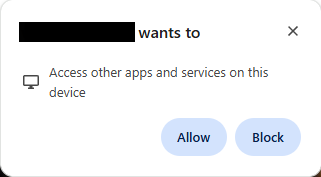
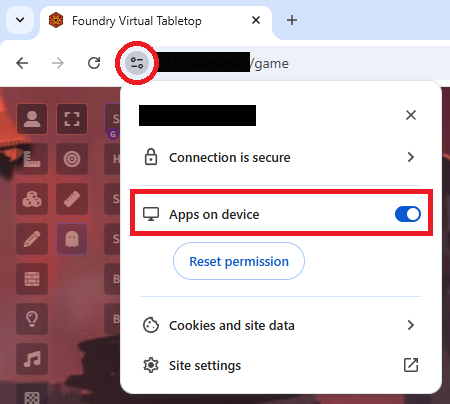

### OpenDeck
OpenDeck is an open-source alternative to the official Stream Deck application that runs on Windows, MacOS and Linux. While Material Deck is currently fully functional in OpenDeck, you should consider it unofficially supported. This means that there is no guarantee that Material Deck will keep functioning on OpenDeck, and OpenDeck-specific issues might not be solved.

Please note that the default [profiles](../profiles/profiles.md) cannot be imported into OpenDeck. This means that you will have to create your own from scratch.

Most of this documentation will assume the use of the official Stream Deck application, it is up to you to figure out how this translates to OpenDeck. 

1. Download and install [OpenDeck](https://github.com/nekename/OpenDeck/releases)
2. For the Ajazz AKP153 (and similar devices), you will need [this](https://github.com/4ndv/opendeck-akp153) plugin
3. Install the [Material Deck plugin](#material-deck-plugin)
4. Make sure the browser is allowed to [access the plugin](#allowing-browser-access-to-the-plugin)
5. [Test if everything works](#testing-if-everything-works)

!!! warning "Chrome, Brave, Adblockers and Script Blockers"
    Chrome, Brave and other browsers have settings that may prevent a communication between Foundry and the Stream Deck application. 
    Similarly, browser plugins/extensions can block the connection. 
    See [here](#allowing-browser-access-to-the-plugin) for more info.

 

## Material Deck Plugin
The Material Deck plugin is what allows the Stream Deck to communicate with Foundry.

1. Download the latest plugin file (com.cdeenen.materialdeck.streamDeckPlugin) from [here](https://github.com/MaterialFoundry/MaterialDeck_SD/releases) or get it from the [Download Utility](../moduleSettings/downloadUtility.md)
2. In OpenDeck, click `Plugins` (near the top), which opens the `Manage plugins` window
3. Click `Install from file`
3. Navigate to the downloaded plugin file and select it

## Allowing Browser Access to the Plugin

By default, some browsers may prevent connections between a secured website and local apps and services (which the Stream Deck plugin is).

You might see a pop-up appear when you first access your Foundry server, which asks you to allow this access. If you see this popup, select `Allow`.

 

If you do not see that pop-up, click the icon to the left of the address bar and make sure `Apps on device` is enabled.

On older versions of Brave you have to disable the shields for your Foundry server:
1. Press the lion icon to the right of the address bar
2. Set shields to 'down'

 

### Browser Plugins/Extensions
Some browser plugins/extensions such as ad-blockers and script blockers may prevent the connection between Foundry and the Stream Deck.
If you run into connection issues, try disabling the extension or whitelist your Foundry server.

## Testing If Everything Works
You can now test if a connection can be established between the Stream Deck and Foundry:

1. Make sure the Stream Deck is connected to your computer and you are running OpenDeck
2. Start a world in Foundry and access it (or refresh it)
3. A notification should appear stating `Material Deck: Connected to Stream Deck`, which means the connection is established
4. In OpenDeck, drag a 'Token' action to one of the buttons (see [here](../actions/actions.md) if you don't know how to do that)
5. Select a token in Foundry, its icon and name should appear on the Stream Deck