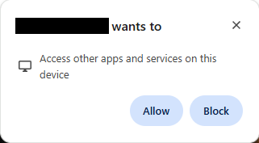
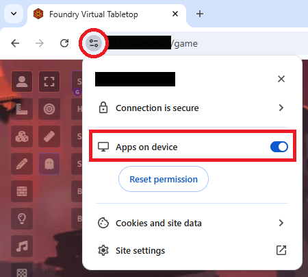

The [official Stream Deck application](https://www.elgato.com/ww/en/s/downloads) is the default communication method for Material Deck.

It only works on Windows and MacOS, and only with supported Elgato devices. Linux users, or users of non-Elgato [compatible devices](./requirements.md#compatible-devices) will need to use [OpenDeck](./openDeck.md) or [WebHID](./webHID.md).

Follow the following steps to install and configure the Stream Deck application:

1. Download and install the [Stream Deck application](https://www.elgato.com/ww/en/s/downloads)
2. Install the [Material Deck plugin](#material-deck-plugin)
3. Make sure the browser is allowed to [access the plugin](#allowing-browser-access-to-the-plugin)
4. [Test if everything works](#testing-if-everything-works)

!!! warning "Chrome, Brave, Adblockers and Script Blockers"
    Chrome, Brave and other browsers have settings that may prevent a communication between Foundry and the Stream Deck application. 
    Similarly, browser plugins/extensions can block the connection. 
    See [here](#allowing-browser-access-to-the-plugin) for more info.

 

## Material Deck Plugin
The Material Deck plugin is what allows the Stream Deck to communicate with Foundry.

1. Download the latest plugin file (com.cdeenen.materialdeck.streamDeckPlugin) from [here](https://github.com/MaterialFoundry/MaterialDeck_SD/releases) or get it from the [Download Utility](../moduleSettings/downloadUtility.md)
2. Double-click the file, this should open the Stream Deck software if it's not open yet
3. Press 'Install' in the pop-up

If that doesn't work, you can try the following:

1. Download the source code from [here](https://github.com/MaterialFoundry/MaterialDeck_SD/archive/refs/tags/v1.7.2.zip)
2. Extract the file (using, for example, [WinRAR](https://www.win-rar.com/start.html?&L=0))
2. Copy the `com.cdeenen.materialdeck.sdPlugin` folder (in the 'Plugin' folder) to:
    * Windows: `%appdata%\Elgato\StreamDeck\Plugins\`
    * MacOS: `~/Library/Application Support/com.elgato.StreamDeck/Plugins/`
3. Restart the Stream Deck application.

## Allowing Browser Access to the Plugin

By default, some browsers may prevent connections between a secured website and local apps and services (which the Stream Deck plugin is).

You might see a pop-up appear when you first access your Foundry server, which asks you to allow this access. If you see this popup, select `Allow`.

 

If you do not see that pop-up, click the icon to the left of the address bar and make sure `Apps on device` is enabled.

On older versions of Brave you have to disable the shields for your Foundry server:
1. Press the lion icon to the right of the address bar
2. Set shields to 'down'

 

### Browser Plugins/Extensions
Some browser plugins/extensions such as ad-blockers and script blockers may prevent the connection between Foundry and the Stream Deck.
If you run into connection issues, try disabling the extension or whitelist your Foundry server.

## Testing If Everything Works
You can now test if a connection can be established between the Stream Deck and Foundry:

1. Make sure the Stream Deck is connected to your computer and you are running the Stream Deck app
2. Start a world in Foundry and access it (or refresh it)
3. A notification should appear stating `Material Deck: Connected to Stream Deck`, which means the connection is established
4. In the Stream Deck app, drag a 'Token' action to one of the buttons (see [here](../actions/actions.md) if you don't know how to do that)
5. Select a token in Foundry, its icon and name should appear on the Stream Deck