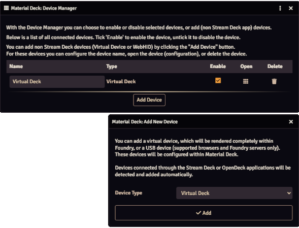
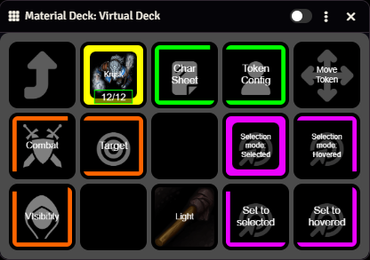
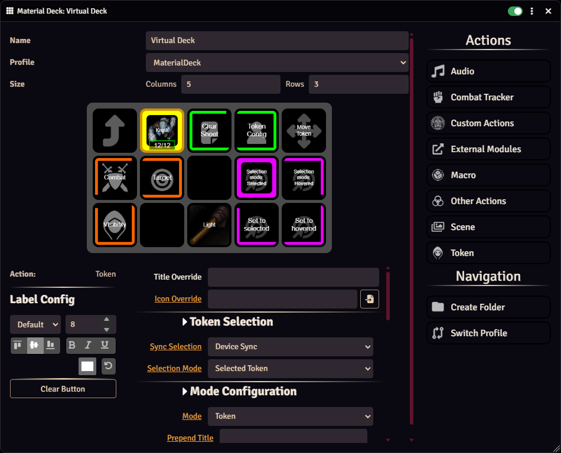
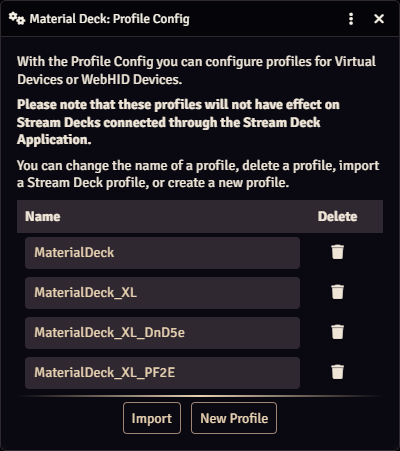

<b>Virtual Decks are currently experimental, so it may be a bit buggy.</b>

Virtual Decks are, as the name suggests, virtual Stream Decks. These will act like normal Stream Decks, but they're fully configured and rendered inside Foundry. Virtual Decks can be detached in Foundry v14 so they're rendered in a separate browser window.

Configured [WebHID devices](webHID.md) can also be used as a Virtual Deck.

## Adding Virtual Decks

1. Open the [Device Manager](../moduleSettings/deviceManager.md).
2. At the bottom, click `Add Device`.
3. Select `Virtual Deck`.
4. Click `Add`.

## Removing Virtual Decks
1. Open the [Device Manager](../moduleSettings/deviceManager.md).
2. Press the `Delete` icon for the device you want to remove.

## Opening Virtual Decks
1. Open the [Device Manager](../moduleSettings/deviceManager.md).
2. Press the `Open` icon next to the device.

The [Other Actions](../actions/otherActions.md#material-deck) action has the `Material Deck` function which provides a `Open Virtual Deck` mode to open or close a Virtual Deck. 
You can also create a macro/console command to open a Virtual Deck by clicking the 3 dots in the header of a Virtual Deck and selecting `Copy "Open" Command`. You can then paste this into a script macro or the console to open or close that specific Virtual Deck.

## Configuring Virtual Decks

You can configure a Virtual Deck by clicking the `Open` icon next to the device in the [Device Manager](../moduleSettings/deviceManager.md).

The Virtual Deck opens in `play` mode. In this mode you can use it as a normal Stream Deck: You can click or hold one of the buttons and buttons are updated like normal. 
You can enter `edit` mode by clicking the slider in the header (at the top).

In `edit` mode, the Virtual Deck app can be divided into the following sections:

* <b>[Device Configuration](#device-configuration)</b>: Configure the device name, profile and size.
* <b>[Buttons](#buttons)</b>: The Virtual Deck buttons.
* <b>[Property Inspector](#property-inspector)</b>: Configure a selected button.
* <b>[Action List](#action-list)</b>: List of actions to be dragged onto the buttons.

 

### Device Configuration
In the Device Configuration (topmost) section you can configure the following:

#### Device Name
Sets the name of the device.

#### Profile
Sets the profile for the device. From the dropdown you can select one of the existing profiles, create a new profile, or open the [Profile Config](#profile-config).

#### Size
Sets the size of the device.

### Buttons
The Buttons section displays all buttons of the device. If an action is configured for the button, left-clicking it will populate the [Property Inspector](#property-inspector) so you can edit that button. 
Right-clicking the button will open a context menu with the following options:

* <b>Click</b>: Emulates a normal press of the button.
* <b>Copy</b>: Copy the button.
* <b>Paste</b>: Paste a previously copied button onto the selected button.
* <b>Clear</b>: Clear the button.

You can move the buttons around by left-click and dragging a button.

### Property Inspector
The Property Inspector (bottommost section) is where you can configure buttons. Select the button you want to configure to populate the Property Inspector.

In the left side of the Propery Inspector you can see what action is assigned to the button, you can configure the label, and clear the button.

In the right side of the Property Inspector you can configure the contents of the button and what it does on a press. See [here](../actions/actions.md) for more information of the actions and how they can be configured.

### Action List
The Action List section shows all available actions that can be assigned to a button. Simply drag the action onto one of the buttons. See [here](../actions/actions.md) for more information of the actions and how they can be configured.

## Profile Config

You can access the Profile Config through the [Profile](#profile) dropdown.

Here you can see an overview of all available profiles, rename profiles, delete profiles, create new profiles, and import profiles.

### Renaming Profiles
Select the textbox of the profile you want to rename and give it a new name.

### Deleting Profiles
Press the `Delete` icon next to the profile you want to delete.

### Creating New Profiles
Press the `New Profile` button.

### Importing Profiles
Press the `Import` button. This will open a new window where you can select the profile you want to import. 
You can import normal Stream Deck profiles from the Stream Deck app (`.streamDeckProfile` files). This will only import compatible actions from that profile:

* All [Material Deck actions](../actions/actions.md#actions)
* Create Folder
* Switch Profile