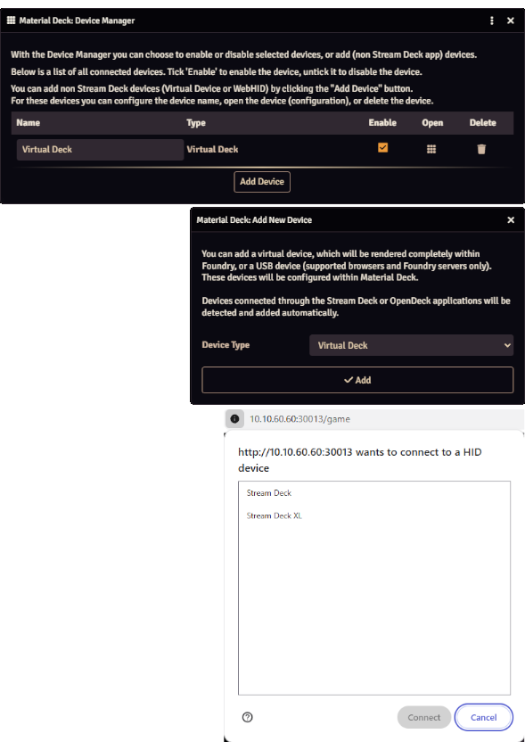

<b>WebHID support is currently experimental, so it may be a bit buggy.</b>

WebHID is a way that browsers can communicate directly with hardware. This means that a separate application is not necessary. 
Most genuine Stream Deck devices are supported, however, at the moment only buttons are implemented. Support for dials of the Stream Deck + will be added later.

1. Make sure all [requirements](#requirements) are met.
2. [Add](#adding-webhid-devices) a WebHID device.
3. [Configure](./virtualDeck.md#configuring-virtual-decks) the device.

After a device has been configured, your browser will automatically connect to the WebHID device whenever you refresh or connect the device to your computer.

Configured WebHID devices can also be used as a [Virtual Deck](./virtualDeck.md), also if the WebHID device is not connected.

## Requirements
Before proceeding, make sure the following requirements are met:

* You're using a compatible (Chromium-based) browser. See [here](https://developer.mozilla.org/en-US/docs/Web/API/WebHID_API#browser_compatibility) for an overview. The Foundry app is not supported.
* Your Foundry server is secured (using https), see [below](#secure-foundry-servers). It is possible to use WebHID on insecure servers by reducing your browser's security settings.
* The Stream Deck application is <ins>not</ins> running.
* The settings in the table below are configured in the [Module Settings](../moduleSettings/moduleSettings.md):

| Setting Category  | Setting   | Required Value    |
|--|--|--|
| General                               | Enable Module for This Client | Checked   |
| Stream Deck App & OpenDeck Connection | Enable Websocket Connection   | Unchecked |
| WebHID Connection                     | Enable WebHID Connection      | Checked   |

### Secure Foundry Servers
Secure Foundry servers are servers that are SSL secured. They can be identified by a URL that starts with `https` instead of `http`. Some browsers will also show a lock icon next to the navigation bar to indicate the site you're visiting is secure.

Hosting services will provide a secure server, for self hosted servers you will have to configure this yourself.

### Insecure Foundry Servers
WebHID is supposed to only work on secured webservers, however, it is possible to reduce your browser's security by whitelisting your Foundry server.

!!! warning "Security Warning"
    It is generally not a good idea to reduce your browser's security. Probably nothing will go wrong, but proceed with caution and at your own risk.

 

1. Find the `Insecure origins treated as secure` browser setting (you can use the table below to find your browser's setting)
2. Set the setting to `Enabled`
3. Add your servers URL to the textbox, e.g. `192.168.1.10:30000`
4. Relaunch the browser

| Browser   | URL       |
|--|--|
| Chrome    | `chrome://flags/#unsafely-treat-insecure-origin-as-secure`    |
| Brave     | `brave://flags/#unsafely-treat-insecure-origin-as-secure`     |
| Edge      | `edge://flags/#unsafely-treat-insecure-origin-as-secure`      |

## Adding WebHID Devices
1. Open the [Device Manager](../moduleSettings/deviceManager.md).
2. At the bottom, click `Add Device`.
3. Select `USB Device (WebHID)`. If this option does not appear, make sure that you've fulfilled all [requirements](#requirements).
4. Click `Add`, which should open a popup.
5. In the popup, select your Stream Deck device and click `Connect`.

## Removing WebHID Devices
1. Open the [Device Manager](../moduleSettings/deviceManager.md).
2. Press the `Delete` icon for the device you want to remove.

## Configuring WebHID Devices
Device configuration for WebHID devices is almost identical to [Virtual Deck configuration](./virtualDeck.md#configuring-virtual-decks). The only difference is that you cannot change the size.