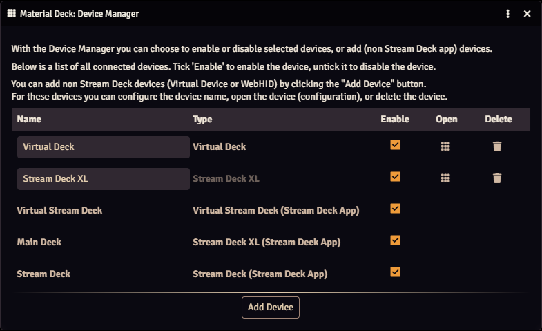

The Device Manager allows you to configure all devices. You can access the device manager through the [module settings](./moduleSettings.md).

## Name
Name of the device. This is configurable for [Virtual Deck](../gettingStarted/virtualDeck.md) and [WebHID](../gettingStarted/webHID.md) devices. Names for devices connected through the Stream Deck app or through OpenDeck will need to be configured in those apps.

## Type
Displays the device type (e.g. Stream Deck XL) and how they're connected (e.g. through the Stream Deck app or WebHID).

## Enable
The Enable checkbox allows you to prevent certain devices from connecting. This is essential if you have multiple devices and run multiple Foundry clients on the same computer.

For example: you have a GM client that you want to use a Stream Deck XL for, and a player client (for example for an in-person setup) that you want to use a normal Stream Deck for. If both Stream Deck's are allowed to connect to both clients, the Stream Decks will get 'confused' about which client it should communicate to. 
To solve this, you untick 'enable' for the normal Stream Deck in the device manager on the player client, and you untick it for the Stream Deck XL in the device manager on the GM client.

## Open
Opens a [Virtual Deck](../gettingStarted/virtualDeck.md) or [WebHID](../gettingStarted/webHID.md) device as a Virtual Deck. You can configure these devices through this button.

## Delete
Delete a [Virtual Deck](../gettingStarted/virtualDeck.md) or [WebHID](../gettingStarted/webHID.md) device.